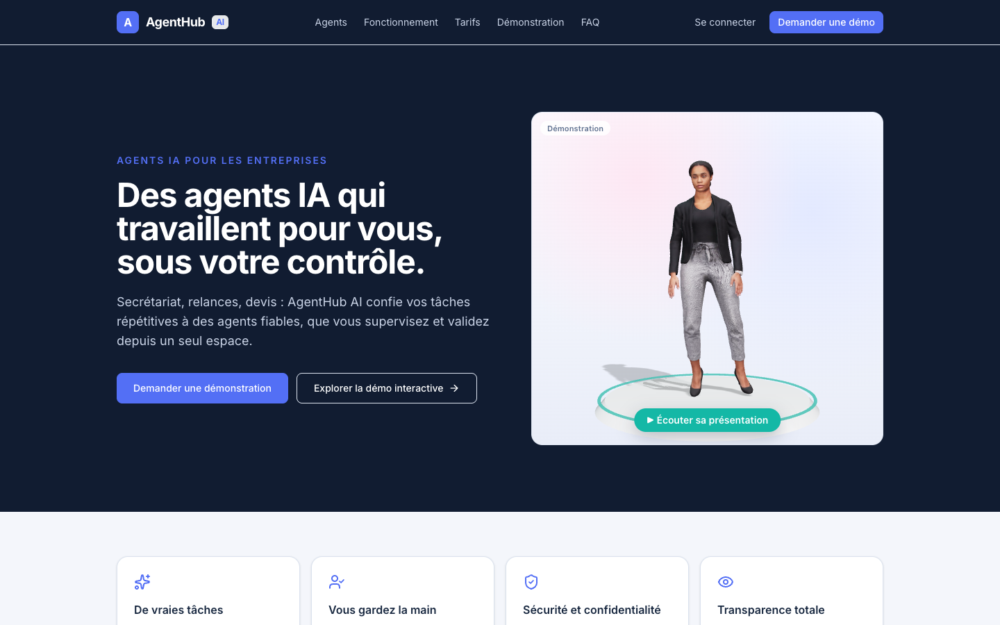
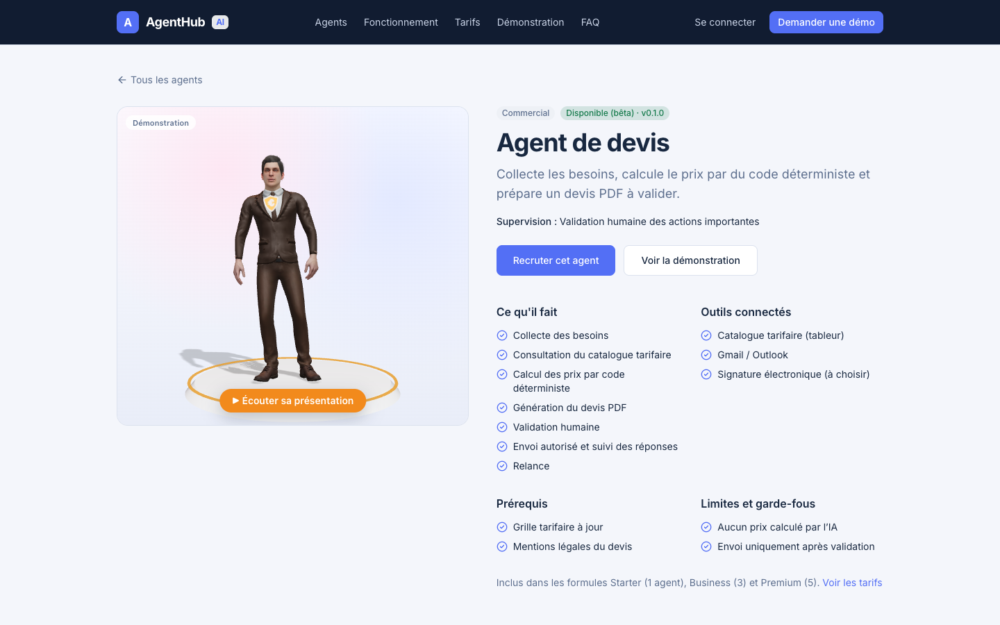
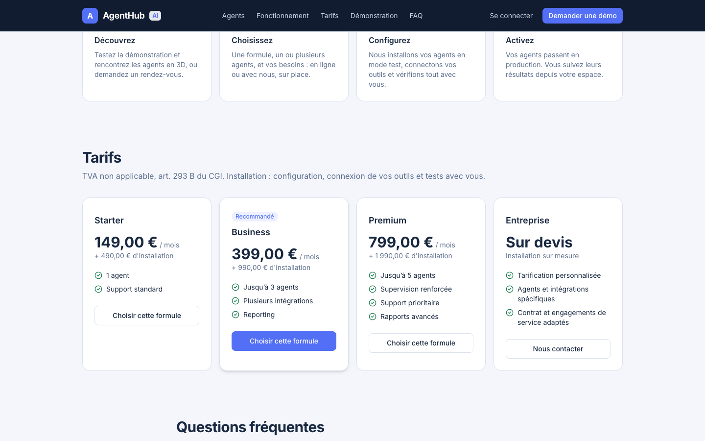
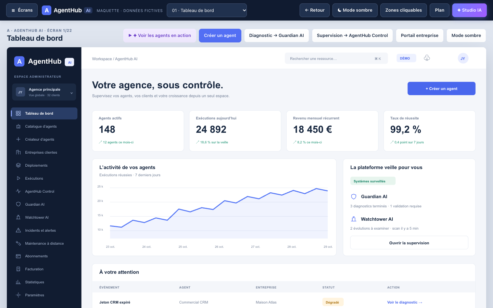
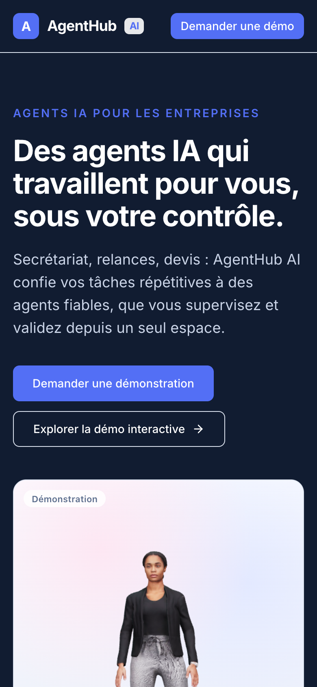

# AgentHub AI

**Des agents IA qui travaillent pour les entreprises, sous leur contrôle.**

Plateforme SaaS en production : [agenthub-ai.fr](https://agenthub-ai.fr) · [démo interactive](https://agenthub-ai.fr/demo)

Conçue, développée et déployée seul par [Josserand Yole](https://github.com/jossyole-rgb). Le code source est privé (produit commercial) ; ce dépôt présente le projet. Accès au code sur demande pour un recrutement : joss.yole@gmail.com.

## Ce que fait la plateforme

Une entreprise choisit une formule, recrute un ou plusieurs agents et les supervise depuis son espace. Trois agents sont opérationnels (version bêta) :

| Agent | Rôle |
| --- | --- |
| Secrétaire virtuelle | Trie les demandes entrantes, propose des créneaux de rendez-vous sans double réservation, prépare les réponses |
| Agent de relance | Prépare les relances au bon moment selon des règles fixées par l'entreprise |
| Agent de devis | Collecte les besoins et prépare un devis PDF ; les prix sont calculés par du code à partir du catalogue du client, jamais par l'IA |

Par défaut, aucun message ne part sans validation humaine. Chaque exécution est tracée avec son résultat et son coût.

## Fonctions principales

- **Multi-entreprises** : chaque client dispose d'un espace isolé, avec rôles (administrateur, membre) et invitations.
- **Souscription en ligne** : Stripe Checkout (frais d'installation + abonnement mensuel), webhook signé qui active l'accès, portail de facturation et résiliation en fin de période.
- **Console d'administration** : catalogue d'agents, entreprises clientes, déploiements en mode test puis production, journal d'audit.
- **Site public** : présentation des agents avec personnages 3D, démonstration vocale, pages juridiques (CGV, DPA, confidentialité).

## Architecture et choix techniques

| Couche | Technologie |
| --- | --- |
| Application | Next.js 16 (App Router, Server Actions, Partial Prerendering), TypeScript, Tailwind CSS |
| Données et authentification | Supabase : PostgreSQL avec Row Level Security, authentification avec double facteur (MFA) |
| Agents | Paquet TypeScript indépendant du framework, API OpenAI, sorties structurées validées par Zod |
| Paiement | Stripe (Checkout, webhooks, portail client) |
| E-mail | SMTP Brevo |
| Hébergement | Vercel (région Paris), base de données en Irlande (UE) |
| Organisation | Monorepo pnpm : `apps/web`, `packages/core`, `packages/agents`, `packages/db` |

**Sécurité**
- Isolation des données de chaque entreprise appliquée par la base elle-même (politiques RLS), pas seulement par le code.
- Double authentification obligatoire pour les administrateurs.
- Contenus reçus par les agents traités comme des données non fiables (protection contre l'injection d'instructions).
- Garde-fou explicite empêchant l'utilisation d'une clé Stripe réelle sans activation volontaire.

**Qualité**
- Tests unitaires (Vitest) sur la logique métier et les agents.
- Tests des politiques de sécurité de la base sur un PostgreSQL réel (isolation entre entreprises, droits par rôle).
- Intégration continue GitHub Actions : lint, typage, tests, migrations et build à chaque envoi.

## Démonstration

La [démo interactive](https://agenthub-ai.fr/demo) est une maquette de 22 écrans (données fictives) qui montre la vision complète du produit : tableau de bord, création d'agents, supervision et studio 3D.

## Contact

Josserand Yole · joss.yole@gmail.com · [GitHub](https://github.com/jossyole-rgb)
